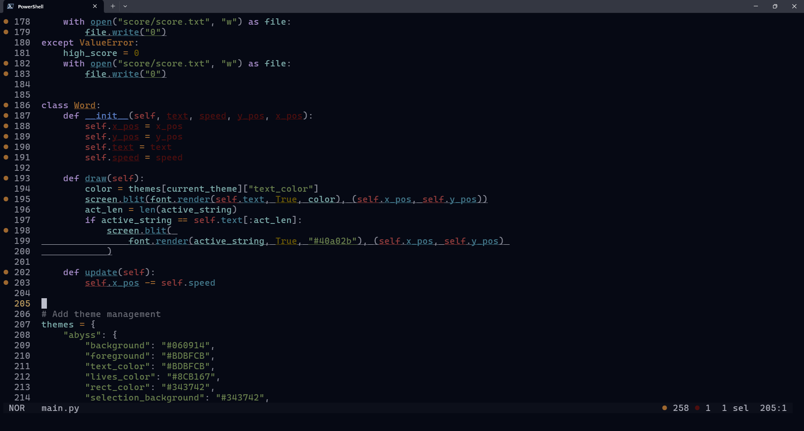

<h1 align="center" valign="middle" >
  
  <sup>yorumi for helix - deep code, quiet sea</sup> 
</h1>

 


Yorumi – a calming deep sea colorscheme for developers. 
This color scheme is crafted to keep things mellow with low contrast vibes between components, 
while your text stays razor-sharp and easy on the eyes (~8:1 contrast ratio). 
Perfect for those late-night marathon coding sessions or when you just want to feel like you're in a cozy nook. 
Less eye strain, more code magic. Dive into the soothing world of yorumi and keep your coding cool.

[Find Yorumi](https://github.com/yorumicolors/yorumi#applications) or [Request a port](https://github.com/yorumicolors/yorumi/issues/new?assignees=&labels=port&projects=&template=port-request.md&title=%5BPORT%5D+%3CAPP-NAME%3E) for your favorite application.

### Installation and Usage

Download the theme file into a config location:

- Windows: `C:\Users\Username\AppData\Roaming\helix\themes\yorumi_choice.toml`
- Linux/Mac: `~/.config/helix/themes/yorumi_choice.toml`

Add the theme key to the top of your `config.toml`
```toml
theme = "yorumi_abyss"
# ...
```

### Themes
- abyss: the dark colorscheme
- mist: the lighter version
  
> A light version of this colorscheme is in the making and will soon be available as `mist`

### Accessibility
The text colors maintain a 7:1 contrast ratio, [WCAG 2.1 Level AAA](https://www.w3.org/TR/WCAG21/#contrast-enhanced).
